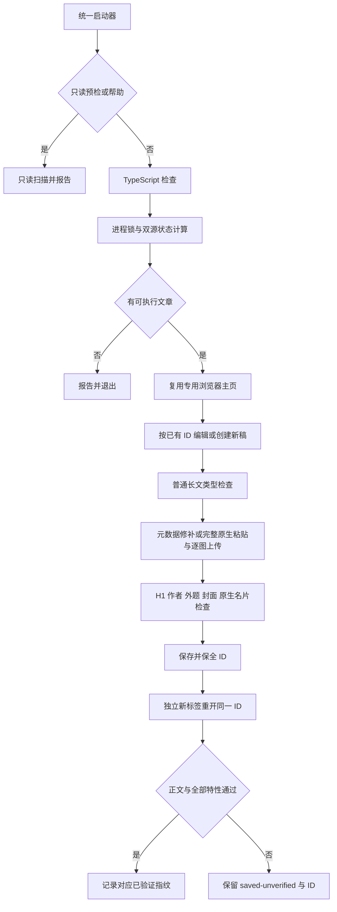

# 草稿编辑架构

## 运行入口

`bin/launch-publisher.mjs` 负责运行时定位、`--check` 转换、正式写入前类型检查与退出码传播。`batch-fast-wechat.ts` 负责参数解析、动作规划、浏览器编辑与验收。`sync-wechat-drafts.ts` 和包内 start/batch 命令转发到启动器。

## 状态

`draft-state.ts` 扫描 Muse 与本地独立目录，以 `source:batch:prefix` 标识文章，以微信 `appmsgid` 标识远端草稿。来源只读，历史与缓存写独立私有目录。

- 历史合并保留未出现在本次来源扫描中的映射。
- 坏 JSON 失败关闭，缺图和同步未稳定时保留 ID。
- 进程锁阻止同一状态库的并发编辑。
- 旧基线缺少确认映射时待核对，不自动当新文章创建。
- observedFingerprint 描述当前源；appliedFingerprint 仅在完整正文与图片保存后通过复验时推进。
- 元数据修补仅更新 featureRepairObservedFingerprint 与版本，不把未实际写入的源正文标为已应用。
- 微信可能自动保存新稿。失败时若已分配 ID，先独立重开核对完整文章身份，再保全为未验收，避免再次创建。

## 编辑器

`editor-mode.ts` 在编辑前检查消息类型、祖先隐藏状态、正文可见性和可编辑性。图片轮播消息的隐藏 ProseMirror 不能作为普通长文编辑器。

`editor-input.ts` 在任务自有标签准备 HTML，原生复制到系统剪贴板，再在准确的正文选区原生粘贴，要求实际可信 HTML paste 事件。完整正文比对文本，逐张图片以唯一文字标记定位，再通过本地图片 input 上传和相邻新图检查完成。

`editor-features.ts` 处理标题、封面和原生名片。最后由编排器检查唯一完整首位 H1、作者、外题、封面、名片居尾以及残余标记。

## 保存与复验

保存后先保全 ID，再关闭原编辑标签，新开任务标签从服务器读同一 ID。等待媒体加载，比较正文文字、图片素材身份与顺序，检查 H1、作者、外题、封面和真正原生名片。微信 CDN 的 `/0` 与 `/640` 可能是同素材的显示尺寸；仅在合法 qpic 域名规范化这两个尺寸，不放宽素材路径或顺序。

真实正文、登录态、状态映射、名片模板、诊断截图和报告留在私有目录。公开仓库仅包含通用代码、说明与合成测试数据。
